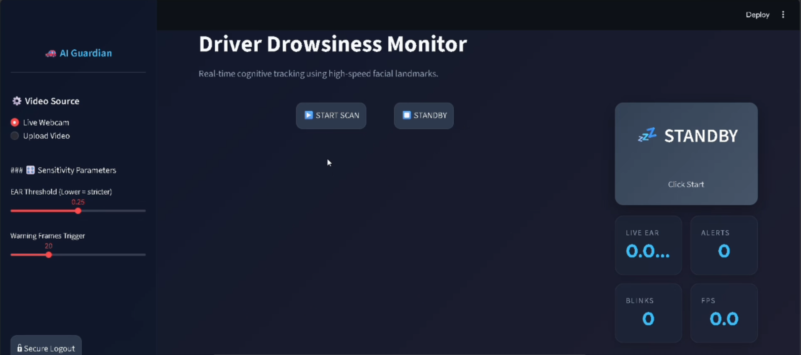

# 🚗 Driver Drowsiness Detection System

A real-time AI-powered driver drowsiness monitoring system built with **Python**, **Streamlit**, and **Google MediaPipe**. It uses facial landmark detection and Eye Aspect Ratio (EAR) analysis to detect drowsiness and alert the driver instantly.

---

## 📸 Features

- 👁️ **Real-time Eye Tracking** — Detects eye closure using MediaPipe Face Landmarker
- 📊 **Live Metrics Dashboard** — FPS, Live EAR, Blink Count, Alert Count
- 🚨 **Drowsiness Alerts** — Audio beep + pulsing visual warning when drowsiness is detected
- 🗺️ **Nearest Rest Stop Suggestions** — Auto-displays nearby safe stops after sustained drowsiness
- 🎥 **Dual Input Support** — Works with live webcam or uploaded video file
- 🎛️ **Adjustable Sensitivity** — Tune EAR threshold and warning frame count from the sidebar
- 💅 **Glassmorphism UI** — Sleek dark-mode interface with smooth animations

---

## 📸 Screenshots

### Live Monitoring Dashboard



## 🧠 How It Works

The system uses the **Eye Aspect Ratio (EAR)** algorithm:

```
EAR = (|p2 - p6| + |p3 - p5|) / (2 * |p1 - p4|)
```

- When EAR drops below the threshold → eyes are likely closed
- If eyes stay closed for `N` consecutive frames → drowsiness alert fires
- An audio beep plays and the UI switches to a critical warning state

---

## 🛠️ Tech Stack

| Layer | Technology |
|-------|-----------|
| UI | Streamlit 1.57+ |
| AI Model | Google MediaPipe Face Landmarker |
| Computer Vision | OpenCV |
| Math / Distance | SciPy |
| Language | Python 3.10+ |

---

## 🚀 Getting Started

### 1. Clone the Repository

```bash
git clone https://github.com/Laksh4vyas/Driver-Drowsiness.git
cd Driver-Drowsiness
```

### 2. Create a Virtual Environment

```bash
python -m venv .venv
.venv\Scripts\activate      # Windows
source .venv/bin/activate   # macOS/Linux
```

### 3. Install Dependencies

```bash
pip install streamlit opencv-python mediapipe scipy numpy
```

### 4. Run the App

```bash
streamlit run app.py
```

The app will open at **http://localhost:8501**

---


## ⚙️ Configuration (Sidebar Controls)

| Setting | Default | Description |
|---------|---------|-------------|
| EAR Threshold | `0.25` | Eye Aspect Ratio cutoff. Lower = stricter |
| Warning Frames | `20` | Consecutive closed-eye frames before alert |
| Video Source | Webcam | Switch between live camera or uploaded video |

---

## 📁 Project Structure

```
Driver-Drowsiness/
│
├── app.py                  # Main Streamlit application
├── face_landmarker.task    # MediaPipe model (auto-downloaded on first run)
├── README.md
└── .venv/                  # Virtual environment
```

---

## 📝 Notes

- The **MediaPipe Face Landmarker model** (~30 MB) is automatically downloaded on first run
- Audio alerts use `winsound` on Windows — a terminal bell fallback is used on other OS
- The app requires **camera permissions** for live webcam mode

---

## 👤 Author

**Laksh Vyas**  
[GitHub](https://github.com/Laksh4vyas)

---

## 📄 License

This project is open source and available under the [MIT License](LICENSE).
#
